# Esteira Analítica PNCP — SC TECH

Esteira de dados ponta a ponta para auditoria de contratações públicas federais: **PNCP (CSV) → Python (auditoria e limpeza) → MySQL (Star Schema) → Power BI (dashboard executivo)**.

> Vídeo de apresentação (Review de Sprint): [PREENCHER: link do Google Drive]

---

## 1. Objetivo do projeto

Desenvolver uma esteira analítica de ponta a ponta para transformar dados de contratações públicas do Portal Nacional de Contratações Públicas (PNCP) em uma base estruturada, confiável e preparada para análises de controle e transparência.

**Contexto do problema:** a Controladoria identificou sinais de sobrepreço, concentração de contratos em poucos fornecedores, morosidade entre a publicação do edital e a homologação e baixa competitividade em certas modalidades. Os sistemas de origem não validam os dados na entrada, então a base bruta tem identificadores corrompidos, valores monetários em texto livre, datas despadronizadas e inconsistências de cronograma. O projeto entrega um ambiente analítico confiável, auditável e executivo.

O projeto utiliza Python, Pandas e MySQL para tratar os dados, aplicar regras de negócio e construir tabelas dimensionais, e o Power BI para o dashboard.

---

## 2. Fonte e período dos dados

A base utilizada foi disponibilizada pelo professor e contém dados do PNCP referentes ao ano de 2025, no período de 02/01/2025 a 31/12/2025. É uma **amostra**: os resultados valem para os dados analisados, e não para todo o governo.

Foram utilizados três arquivos CSV:

| Arquivo | Descrição | Registros |
|---|---|---:|
| `compras.csv` | Dados das contratações | 2.042 |
| `itens.csv` | Itens licitados | 7.077 |
| `resultados.csv` | Fornecedores classificados por item | 15.896 |

Os arquivos originais foram mantidos em `data/raw/`, separados dos arquivos resultantes do processamento.

---

## 3. Estrutura do projeto

```text
Esteira-Analitica-PNCP--SC-TECH/
├── data/
│   ├── raw/                # CSVs originais
│   └── processed/          # fato e dimensões geradas pelo Python
├── src/
│   ├── extrair.py
│   ├── limpeza.py
│   ├── montar_tabelas.py
│   ├── banco.py
│   ├── config.py
│   └── carregar.py
├── sql/
│   ├── 01_criar_banco.sql
│   ├── 02_perguntas.sql
│   └── 03_validacao.sql
├── powerbi/                # dashboard_pncp.pbix e tema_auditoria.json
├── docs/
│   └── img/                # prints, diagrama e figura das Sprints
├── .env.example
├── requirements.txt
└── README.md
```

---

## 4. Planejamento em Sprints

O desenvolvimento foi organizado em Sprints, com acompanhamento no **GitHub Projects**.

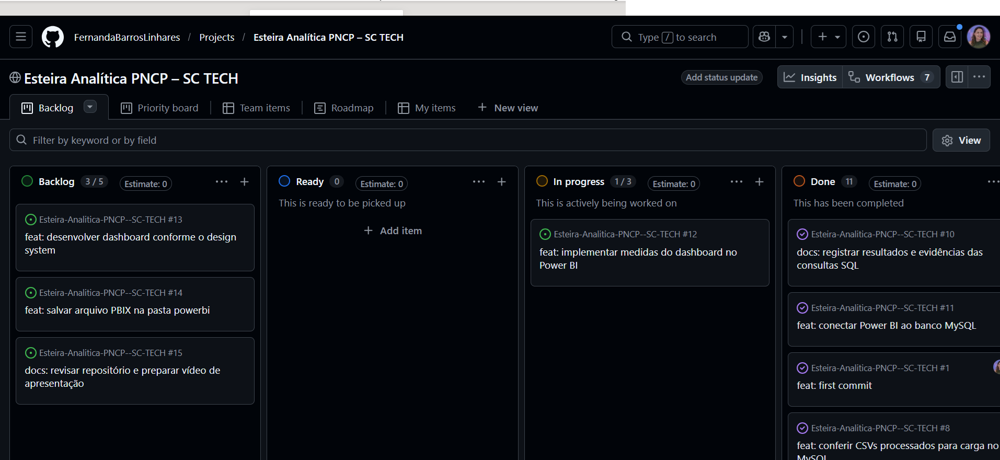

* **Board do projeto:** [Acesse o Board no GitHub Projects](https://github.com/users/FernandaBarrosLinhares/projects/8/views/1)


---

## 5. Decisões técnicas

As regras de negócio da Controladoria foram seguidas como definidas no enunciado:

- **Grão da fato:** um item por contratação (`numero_controle_pncp` + `numero_item`). O banco garante isso com UNIQUE.
- **Um vencedor por item:** primeiro descarta os resultados cancelados, depois escolhe o menor `ordem_classificacao_srp` (vazio vale 1). Se o 1º colocado está cancelado, o 2º assume. Empate: menor `sequencial_resultado`, lido como número.
- **Só entram itens com resultado.** Os 852 itens sem resultado ficam fora e não contam como rejeitados.
- **Itens rejeitados (99):** quantidade vazia ou ≤ 0; valor unitário estimado ou homologado ausente ou ≤ 0; orçamento sigiloso; valor total estimado < R$ 1; valor homologado mais de 1.000× o estimado; qualquer total acima de R$ 1 trilhão. Esses itens não são carregados, e o banco é a segunda barreira (CHECK e DECIMAL).
- **Valores:** `valor_total = valor_unitario × quantidade`, usando a quantidade homologada (ou a do item, se vazia ou zero), para a comparação ser justa.
- **Economia só onde dá para comparar:** item comparável = não é Credenciamento e a razão homologado ÷ estimado está entre 0,1 e 10. Economia % = soma da economia ÷ soma do estimado comparável (nunca média de percentuais). Em Credenciamento o estimado é um teto global, então a economia dele fica vazia.
- **Cronologia:** homologação anterior à publicação fica sem data e sem ciclo, mas o item continua na fato. Ciclo = homologação − publicação, em dias.
- **Separadores numéricos:** ponto ou vírgula sozinho é o decimal; só o separador repetido é milhar. Sem essa regra, o volume sobe de R$ 8 bi para cerca de R$ 31 bi.
- **Perfil do gasto:** Bens, Serviços ou Obras e engenharia. Palavras de obra usadas, com limite de palavra (`\b`): **obra, construção, reforma, engenharia**.
- **Órgão:** o mesmo órgão tem várias unidades (CNPJ). O ranking agrupa pelo nome padronizado, e as unidades compradoras são contadas por CNPJ distinto.

Discordâncias com as regras: [PREENCHER ou escrever "nenhuma"].

---

### 6. Dicionário das inconsistências tratadas

| # | Problema | Onde | Tratamento |
|---|---|---|---|
| 1 | CNPJ/CPF com máscara e zero à esquerda perdido | `cnpj_orgao`, `ni_fornecedor` | Remove a máscara e completa com zeros à esquerda |
| 2 | Dinheiro em texto (R$, milhar e decimal trocados, parênteses) | Valores de itens e resultados | Converte com a regra de separadores e trata valores negativos |
| 3 | Várias máscaras de data no mesmo campo | `data_publicacao`, `data_resultado` | Converte para data padronizada |
| 4 | Homologação anterior à publicação | `data_resultado` | Anula a data inválida e o ciclo |
| 5 | Nulos disfarçados (N/A, NULL, -, SEM INFORMAÇÃO, NÃO SE APLICA; "0" em texto) | Várias colunas | Converte para vazio (`None`) |
| 6 | Acentos quebrados (ç, ã) | Campos textuais | Corrige o encoding UTF-8 |
| 7 | Nomes de órgão e fornecedor escritos de jeitos diferentes | `razao_social_orgao`, `nome_fornecedor` | Padroniza maiúsculas, hífens e espaços |
---

## 7. Como rodar o projeto

### Pré-requisitos

- **Python 3.10+**
- **MySQL Server** ativo
- **pip**

### Passo a passo

1. **Clonar o repositório:**

   ```bash
   git clone https://github.com/FernandaBarrosLinhares/Esteira-Analitica-PNCP--SC-TECH.git
   cd Esteira-Analitica-PNCP--SC-TECH
   ```

2. **Instalar as dependências:**

   ```bash
   pip install -r requirements.txt
   ```

3. **Configurar o banco:** copie `.env.example` para `.env` e preencha os dados de conexão do MySQL (o `.env` não vai para o GitHub).

4. **Organizar os dados brutos:**

   ```bash
   python -m src.extrair
   ```

5. **Testar a limpeza (autoteste):**

   ```bash
   python -m src.limpeza
   ```

6. **Montar a fato e as dimensões:**

   ```bash
   python -m src.montar_tabelas
   ```

   Os arquivos processados são gerados em `data/processed/`.

7. **Carregar no MySQL:**

   ```bash
   python -m src.carregar
   ```

   Cria o banco `pncp_controladoria`, as tabelas e faz a carga em lote.

8. **Validar e consultar:**

   * `sql/01_criar_banco.sql`: estrutura física do banco.
   * `sql/02_perguntas.sql`: consultas das 6 perguntas.
   * `sql/03_validacao.sql`: testes de integridade e contagens.

9. **Dashboard:** abra `powerbi/dashboard_pncp.pbix`, atualize a conexão com o MySQL e clique em Atualizar.

---

## 8. Etapa 1 — Extração e organização dos dados

O script `src/extrair.py` foi executado para organizar os arquivos brutos fornecidos para a atividade.

Após a execução, os três arquivos CSV foram identificados em `data/raw/`, com as seguintes quantidades:

- `compras.csv`: 2.042 registros.
- `itens.csv`: 7.077 registros.
- `resultados.csv`: 15.896 registros.

A conferência das quantidades confirmou que os arquivos esperados estavam disponíveis para as etapas seguintes.

---

## 9. Etapa 2 — Limpeza e padronização

O módulo `src/limpeza.py` reúne funções utilizadas no tratamento dos dados antes da montagem das tabelas analíticas.

As regras contemplam:

- Padronização de documentos de identificação, como CNPJ e CPF.
- Conversão e tratamento de valores monetários.
- Padronização de datas e verificação de coerência temporal.
- Identificação de valores nulos e textos que representam ausência de informação.
- Sanitização e padronização de textos.

As funções de limpeza são aplicadas durante o processamento dos arquivos, reduzindo inconsistências e preparando os dados para os relacionamentos e cálculos posteriores.

---

## 10. Etapa 3 — Montagem das tabelas analíticas

O script `src/montar_tabelas.py` integra os arquivos de compras, itens e resultados, aplica as regras de negócio e gera os arquivos processados em `data/processed/`.

O processamento inclui a identificação dos resultados dos itens, a exclusão de registros inválidos e a preparação da tabela fato e das dimensões.

### Regras de negócio aplicadas

- Relacionamento entre os dados de compras, itens e resultados.
- Tratamento dos itens sem resultado homologado.
- Exclusão de itens inválidos conforme as regras definidas no projeto.
- Seleção do resultado vencedor por item.
- Verificação da coerência entre as datas de publicação e homologação.
- Cálculo de valores e indicadores utilizados nas análises.
- Identificação de itens comparáveis para a análise de economia.

### Modelo dimensional

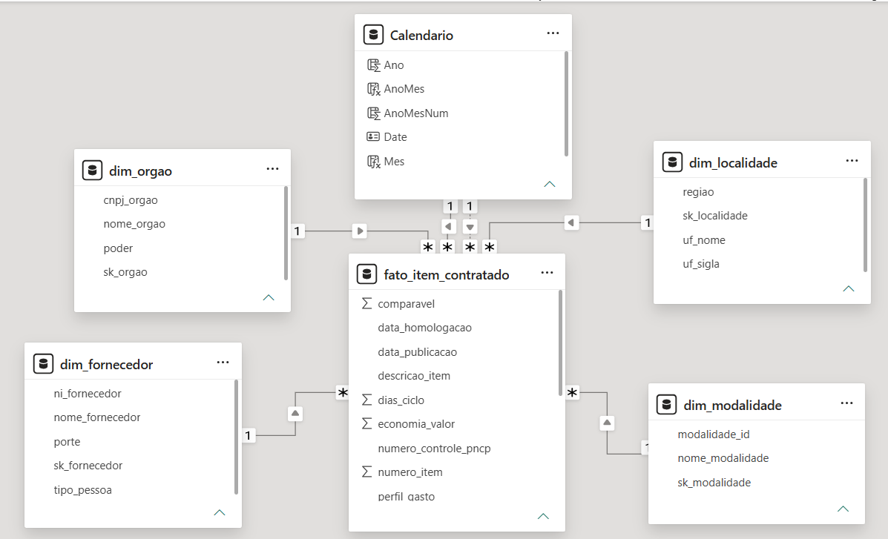

| Tabela | Finalidade | Linhas | Chaves |
|---|---|---:|---|
| `fato_item_contratado` | Itens contratados e suas métricas | 6.126 | PK `sk_fato`; UNIQUE (`numero_controle_pncp`, `numero_item`); FK para as 4 dimensões; CHECK de quantidade e valores |
| `dim_orgao` | Órgãos compradores | 363 | PK `sk_orgao`; UNIQUE `cnpj_orgao` |
| `dim_fornecedor` | Fornecedores | 2.652 | PK `sk_fornecedor`; UNIQUE `ni_fornecedor` |
| `dim_modalidade` | Modalidades de contratação | 7 | PK `sk_modalidade`; UNIQUE `modalidade_id` |
| `dim_localidade` | UF e região | 27 | PK `sk_localidade`; UNIQUE `uf_sigla` |

O tempo é a tabela Calendário, criada em DAX no Power BI.

---

## 11. Validação do processamento Python

O pipeline foi executado pelo comando:

```bash
python -m src.montar_tabelas
```

Os resultados foram comparados com os números de referência disponibilizados no enunciado.

| Indicador | Resultado obtido |
|---|---:|
| Itens com resultado antes dos filtros | 6.225 |
| Itens rejeitados | 99 |
| Registros na tabela fato | 6.126 |
| Contratações distintas | 1.962 |
| Fornecedores distintos | 2.652 |
| Órgãos distintos | 363 |
| Itens comparáveis | 5.457 |
| Economia calculada | 14,46% |
| Ciclo médio de homologação | 48,1 dias |
| Maior ciclo de homologação | 611 dias |
| Itens sem ciclo calculável | 230 |

**Volume total homologado:** R$ 8.044.498.805,74.

### Distribuição do volume homologado

- Obras e engenharia: 60,8%.
- Serviços: 36,6%.
- Bens: 2,6%.

Os resultados apresentados pelo script coincidiram com os valores de referência do enunciado para os indicadores conferidos. Essa validação confirma o processamento Python, mas não substitui a conferência da carga e da integridade dos dados no MySQL.

---

## 12. Evidências

As evidências foram salvas na pasta `docs/img/`, incluindo a saída do console da validação Python e os resultados dos testes de carga no MySQL.

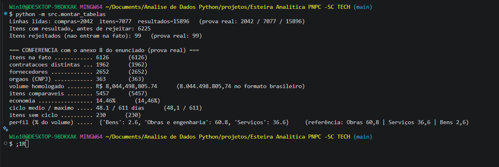

---

## 13. Etapa 4 — Modelagem dimensional no MySQL

Foi elaborado o script SQL para criação do banco de dados `pncp_controladoria` e das cinco tabelas previstas no modelo dimensional.

Tabelas criadas no modelo:

- `dim_orgao`: dados dos órgãos compradores.
- `dim_fornecedor`: identificação e características dos fornecedores.
- `dim_modalidade`: modalidades de contratação.
- `dim_localidade`: unidades federativas e regiões.
- `fato_item_contratado`: itens contratados, valores, datas e indicadores de análise.

A tabela fato utiliza chaves substitutas e chaves estrangeiras para relacionar os registros às quatro dimensões. O modelo também define restrições de unicidade e verificações (CHECK) para quantidades e valores. Valores monetários usam `DECIMAL`, e não `FLOAT`.

Status: script de criação elaborado, executado e validado.

---

## 14. Etapa 5 — Carga e validação no MySQL

A carga é feita por `python -m src.carregar`, que executa o `sql/01_criar_banco.sql`, carrega as 4 dimensões primeiro e a fato depois, em lote.

### Contagens (banco x prova real)

| Tabela | Obtido | Esperado |
|---|---:|---:|
| `fato_item_contratado` | 6.126 | 6.126 |
| `dim_orgao` | 363 | 363 |
| `dim_fornecedor` | 2.652 | 2.652 |
| `dim_modalidade` | 7 | 7 |
| `dim_localidade` | 27 | 27 |

### Validações de integridade (`sql/03_validacao.sql`)

- Soma do valor total homologado: R$ 8.044.498.805,74 (igual à prova real).
- FK solta em órgão, fornecedor, modalidade e localidade: 0.
- Duplicidade do grão (`numero_controle_pncp` + `numero_item`): nenhuma.
<!-- 
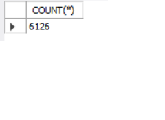
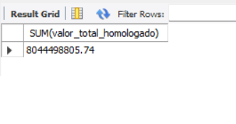
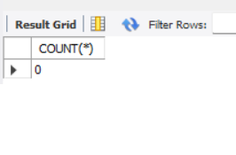
 -->
<!-- 

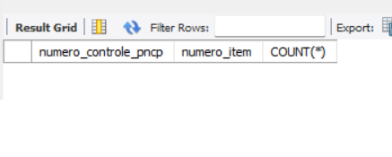 -->

---

## 15. Respostas às perguntas da Controladoria

> *Os resultados valem para a amostra de contratações federais de 2025 analisada, e não para todo o governo.*  
> *Consultas disponíveis em `sql/02_perguntas.sql`.*

### P1 — Economia global

**Resultado:**

| Indicador | Valor |
|---|---:|
| Estimado (itens comparáveis) | R$ 6.867.663.469,91 |
| Economia nominal | R$ 992.861.686,95 |
| Economia % | 14,46% |

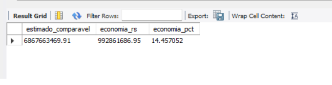

**Conclusão:** nos itens comparáveis, o governo pagou 14,46% abaixo do estimado, o que dá cerca de R$ 993 mi de economia. O cálculo é soma ÷ soma e exclui Credenciamento e itens fora da faixa de 0,1 a 10.

**Insight:** a economia de 14,46% vale só para a parte da base que dá para comparar. Dos 6.126 itens, 5.457 (cerca de 89%) são comparáveis; o restante, incluindo todo o Credenciamento, fica fora do cálculo, embora conte no volume. Misturar tudo distorceria o resultado: o estimado total da fato é R$ 32,6 bi, contra R$ 6,87 bi no estimado comparável. [CONFIRMAR: 27 itens foram homologados acima do estimado (sobrepreço). Só mantenha esta frase se a consulta de apoio da P1 estiver no `02_perguntas.sql`.] Para a Controladoria, o ponto de atenção é que uma parte relevante do dinheiro (principalmente Credenciamento, 26,62% do volume) não tem como medir economia.

---

### P2 — Concentração de fornecedores

**Resultado:**

| Indicador | Valor |
|---|---:|
| Top 10: volume | R$ 3.332.484.029,86 |
| Top 10: % do volume total | 41,43% |
| 1º colocado (NOW SEGUROS SA) | R$ 1,06 bi (13,18%) |

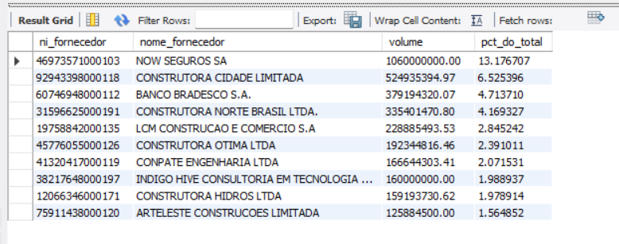
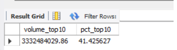
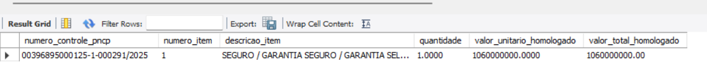

**Conclusão:** na amostra de 2025 analisada, os 10 maiores fornecedores, entre 2.652, concentram R$ 3,33 bi (41,43% do volume homologado). O 1º colocado, NOW SEGUROS SA, responde por 13,18% (R$ 1,06 bi), mas isso vem de um único item: a seleção de seguradora para o Programa de Subvenção ao Prêmio do Seguro Rural, de alcance nacional. Ou seja, parte da concentração decorre de contratos isolados de grande porte, e não de recorrência. Predominam construtoras entre os demais, coerente com o peso de Obras e engenharia.

**Insight:** a concentração é puxada por poucos itens de valor muito alto. Como melhoria futura, vale medir a concentração também por quantidade de itens por fornecedor.

---

### P3 — Eficácia por modalidade

**Resultado:**

| Modalidade | Itens | Volume (R$) | % do volume | Deságio % |
|---|---:|---:|---:|---:|
| Concorrência - Eletrônica | 521 | 4.700.493.122,98 | 58,43 | 14,27 |
| Credenciamento | 601 | 2.141.301.557,16 | 26,62 | n/d |
| Pregão - Eletrônico | 3.046 | 502.223.491,28 | 6,24 | 24,02 |
| Concorrência - Presencial | 63 | 444.752.757,18 | 5,53 | 6,79 |
| Inexigibilidade | 503 | 213.365.238,19 | 2,65 | 8,77 |
| Dispensa | 1.387 | 39.887.350,44 | 0,50 | 4,49 |
| Pregão - Presencial | 5 | 2.475.288,51 | 0,03 | 0,02 |

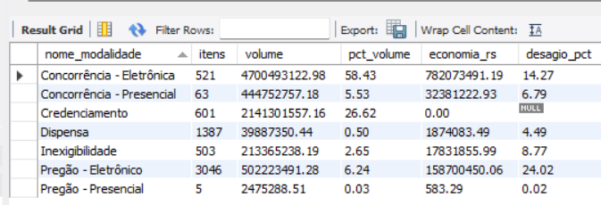

**Conclusão:** na amostra de 2025, a Concorrência - Eletrônica concentra 58,43% do volume, com deságio de 14,27%. O Pregão - Eletrônico tem o maior deságio (24,02%) e movimenta só 6,24% do volume. Credenciamento é o 2º em volume (26,62%), mas não tem deságio comparável, porque o valor estimado é um teto global. Pregão - Presencial tem apenas 5 itens, então seu resultado não é representativo.

**Insight:** volume e economia não andam juntos. A Concorrência - Eletrônica movimenta 58,43% do dinheiro com deságio de 14,27%, enquanto o Pregão - Eletrônico tem o maior deságio (24,02%) com só 6,24% do volume. Para a Controladoria, o ganho potencial está em levar para disputas mais competitivas parte do volume que hoje passa por Credenciamento (26,62% do volume, sem deságio mensurável).

---

### P4 — Tempo do ciclo de compras

**Resultado geral:**

| Indicador | Valor |
|---|---:|
| Itens com ciclo | 5.896 |
| Ciclo médio | 48,1 dias |
| Ciclo máximo | 611 dias |
| Itens sem ciclo | 230 |

**Órgãos com maior ciclo médio** (5 ou mais itens com ciclo, agrupados pelo nome padronizado):

| Órgão | Unidades | Itens com ciclo | Ciclo médio (dias) |
|---|---:|---:|---:|
| Universidade Federal de Campina Grande | 1 | 16 | 266,3 |
| Conselho Federal de Engenharia e Agronomia | 1 | 20 | 223,0 |
| DNIT | 12 | 62 | 156,2 |

**Maiores ciclos individuais:**

| Contratação | Item | Ciclo (dias) |
|---|---:|---:|
| 00394452000103-1-002632/2025 | 17 | 611 |
| 00394452000103-1-002632/2025 | 16 | 581 |
| 00394452000103-1-001751/2025 | 10 | 564 |
| 29979036000140-1-000124/2025 | 1 | 482 |
| 04892707000100-1-000101/2025 | 1 | 437 |

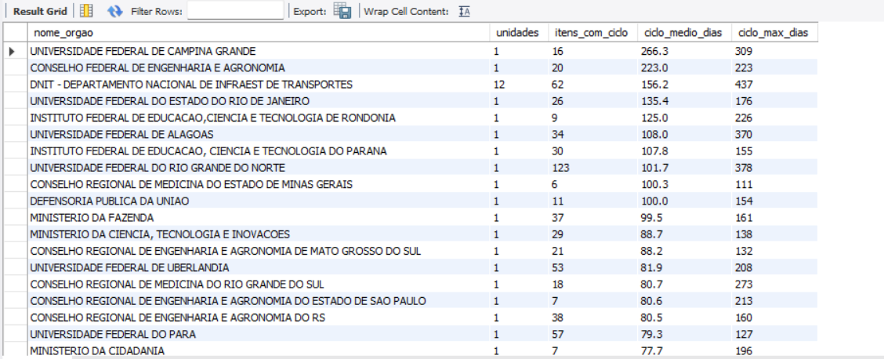
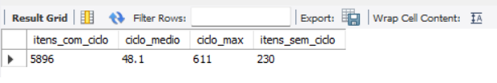
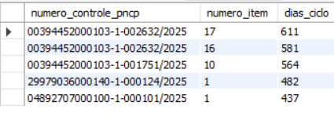
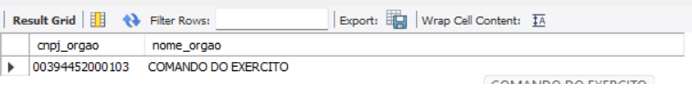

**Conclusão:** na amostra de 2025, o ciclo médio entre publicação e homologação é de 48,1 dias. Alguns órgãos ficam muito acima disso: a UFCG leva 266,3 dias e o Conselho Federal de Engenharia e Agronomia, 223,0. O DNIT, que reúne 12 unidades compradoras, tem média de 156,2 dias. Os maiores ciclos individuais (611, 581 e 564 dias) vêm de duas contratações do Comando do Exército (CNPJ 00394452000103), o que indica atraso em contratações específicas, e não do conjunto da amostra. Os 230 itens sem ciclo (homologação anterior à publicação ou sem data) ficam fora da média, mas continuam na fato.

**Insight:** os órgãos mais lentos do ranking têm ciclo médio bem acima dos 48,1 dias gerais (os 20 primeiros passam de 77 dias). O ranking mistura perfis diferentes:
- A UFCG (266,3 dias) e o Conselho Federal de Engenharia e Agronomia (223,0) têm poucos itens com ciclo (16 e 20), então a média é sensível a poucos casos demorados.
- A UFRN tem 123 itens com ciclo e média de 101,7 dias. O atraso é mais consistente, porque há mais itens por trás do número.
- O DNIT reúne 12 unidades compradoras e tem um item de 437 dias, bem acima da sua média de 156,2.
- Universidades federais e conselhos profissionais aparecem com frequência entre os mais lentos.
- A análise é descritiva: o dado não explica a causa do atraso (complexidade do objeto, recursos, impugnações etc.).

---

### P5 — Distribuição regional

**Por região:**

| Região | Volume (R$) | % do volume | Deságio % |
|---|---:|---:|---:|
| Centro-Oeste | 3.559.879.991,73 | 44,25 | 17,02 |
| Nordeste | 1.850.420.285,02 | 23,00 | 14,18 |
| Sudeste | 1.083.309.811,49 | 13,47 | 11,62 |
| Sul | 1.021.624.955,41 | 12,70 | 7,96 |
| Norte | 529.263.762,09 | 6,58 | 21,43 |

**Principais UFs por volume:**

| UF | Volume (R$) | % do volume | Deságio % |
|---|---:|---:|---:|
| DF | 3.135.638.456,35 | 38,98 | 15,90 |
| RS | 820.584.056,64 | 10,20 | 7,18 |
| RJ | 461.925.602,27 | 5,74 | 11,57 |
| PI | 408.389.525,89 | 5,08 | 5,98 |
| SP | 393.783.392,48 | 4,90 | 9,22 |

**Maiores itens do DF:**

| Contratação | Item | Valor homologado (R$) |
|---|---:|---:|
| 00396895000125-1-000291/2025 | 1 | 1.060.000.000,00 |
| 00396895000125-1-000281/2025 | 1 | 379.194.320,07 |
| 04892707000100-1-000493/2025 | 1 | 335.401.470,80 |
| 37115342000167-1-000089/2025 | 1 | 160.000.000,00 |
| 03353358000196-1-000034/2025 | 1 | 103.600.000,00 |

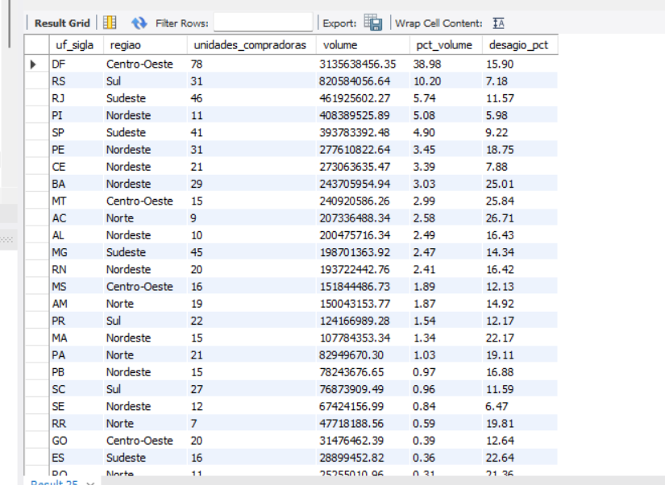
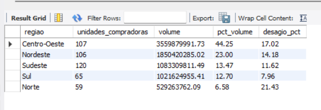
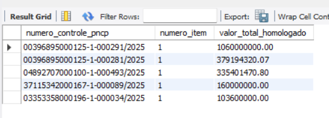

**Conclusão:** na amostra de 2025, o Distrito Federal concentra 38,98% do volume (R$ 3,14 bi) e o Centro-Oeste, 44,25%. Os maiores deságios por UF estão no AC (26,71%), MT (25,84%) e BA (25,01%). Por região, o Norte tem o maior deságio (21,43%), com só 6,58% do volume. O Sul tem o menor (7,96%).

**Insight:** gasto e desconto não coincidem. O volume do DF é puxado por poucos itens de valor muito alto: o seguro rural (R$ 1,06 bi) equivale a cerca de 33,8% do volume do DF, e os 5 maiores itens somam R$ 2,04 bi, cerca de 65%. Isso explica por que o Centro-Oeste lidera o volume. Os maiores descontos aparecem em UFs de baixo volume, como AC e MT, e vêm de poucos itens comparáveis. A localidade é a da contratação, e um mesmo CNPJ de órgão pode aparecer em mais de uma UF, por isso a coluna de unidades compradoras não deve ser somada.

---

### P6 — Perfil dos gastos

**Resultado:**

| Perfil | Itens | Volume (R$) | % do volume | Ticket médio (R$) |
|---|---:|---:|---:|---:|
| Obras e engenharia | 967 | 4.892.362.732,70 | 60,8 | 5.059.320,30 |
| Serviços | 1.849 | 2.940.950.885,18 | 36,6 | 1.590.562,94 |
| Bens | 3.310 | 211.185.187,86 | 2,6 | 63.802,17 |

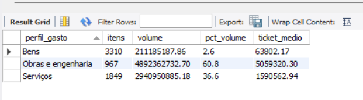

**Conclusão:** na amostra de 2025, Obras e engenharia concentram 60,8% do volume homologado (R$ 4,89 bi), Serviços ficam com 36,6% (R$ 2,94 bi) e Bens com apenas 2,6% (R$ 211 mi). A classificação usa as palavras obra, construção, reforma e engenharia (com limite de palavra, `\b`) na descrição do item e no objeto da contratação; essas palavras têm prioridade sobre Material ou Serviço.

**Insight:** o dinheiro público da amostra está em poucos itens de alto valor. Os 967 itens de Obras (15,8% dos itens) movimentam 60,8% do volume, enquanto os 3.310 itens de Bens (54%) movimentam 2,6%. Para a Controladoria, o risco financeiro está nas obras e nos serviços, não na compra de bens. Como a classificação depende das palavras-chave escolhidas, trocar a lista altera um pouco os percentuais.

---

## 16. Etapa 6 — Dashboard no Power BI

Arquivo: `powerbi/dashboard_pncp.pbix`.

- Importação das 5 tabelas do MySQL (1 fato + 4 dimensões), com contagens conferidas.
- Relacionamentos 1:N das dimensões para a fato, usando as chaves substitutas (`sk_...`), ocultas na exibição de relatório.
- Hora/data automática desligada.
- **Calendário em DAX** com limites vindos dos dados, colunas Ano, Mês, MesNum, AnoMes e AnoMesNum, ordenação por número e marcado como tabela de datas.
- Duas relações do Calendário com a fato: `data_publicacao` (ativa) e `data_homologacao` (inativa, para uso com `USERELATIONSHIP`). Os gráficos por mês usam o mês de publicação do edital.
- **15 medidas** em tabela dedicada, com VAR/RETURN, organizadas em pastas por pergunta.
- Navegação: menu retrátil com botões ☰ e ✕ e indicadores (bookmarks) [CONFIRMAR: ✕ fechando o menu]; botão de limpar filtros e tooltip de página [CONFIRMAR: o que está pronto].
- Cada página segue a estrutura: pergunta, números e conclusão.

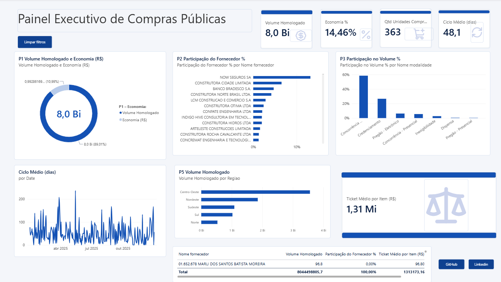

### Medidas

| Pasta | Medidas |
|---|---|
| P1 Economia | Valor Estimado Comparável, Volume Homologado, Economia (R$), Economia %, % de Itens Comparáveis |
| P2 Fornecedores | Participação do Fornecedor %, Ranking do Fornecedor, Concentração Top 10 % |
| P3 Modalidades | Participação no Volume %, Deságio vs Média Geral (p.p.) |
| P4 Ciclo | Ciclo Médio (dias), Ciclo Máximo (dias), Itens sem Ciclo |
| P5 Regional | Qtd Unidades Compradoras |
| P6 Perfil | Ticket Médio por Item (R$) |

Medidas de apoio: Itens com Ciclo e Ciclo Médio (5+ itens), que aplicam a regra de 5 ou mais itens com ciclo no ranking de órgãos. Todas foram conferidas com as consultas do `sql/02_perguntas.sql`.


---

## 17. Tecnologias utilizadas

Python 3 (pandas, mysql-connector), MySQL 8 (Workbench), Power BI Desktop (DAX), Git e GitHub (Projects).

---

## 18. Melhorias futuras

- Mostrar a concentração de fornecedores também sem os itens de valor muito alto.
- Contar itens por fornecedor, além do volume.
- Comparar o ciclo por modalidade.
- Usar também o mês de homologação nas análises de tempo, com `USERELATIONSHIP`.
- Automatizar o pipeline completo em um único comando.
